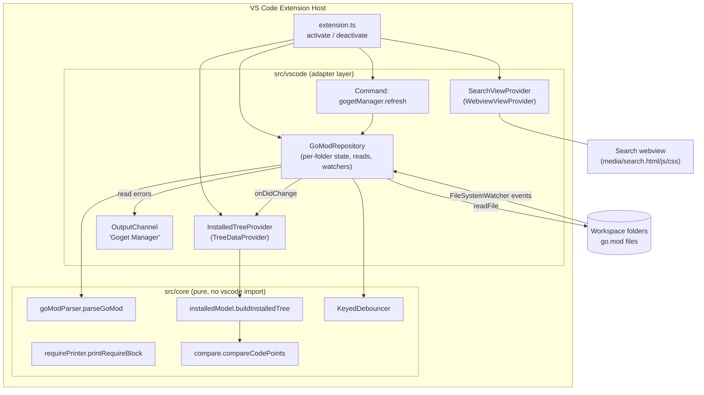
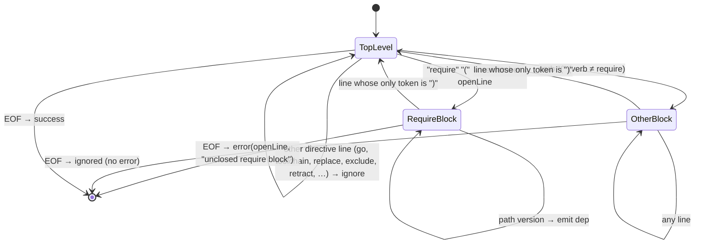

# Design Document: Goget Manager Extension

## Overview

Goget Manager is a VS Code extension written in TypeScript. It adds an Activity Bar icon that opens a side bar container named "Goget Manager" with two views laid out like the Extensions view:

- **Search**: a webview view that hosts a single themed text box. It does not search yet.
- **Installed**: a native tree view that lists every `require` entry from each workspace folder's root `go.mod`, with the package path as the label and the version as the description.

The design splits the code into two layers:

1. A **pure core** (`src/core/`) with no `vscode` import: the go.mod tokenizer/parser, the require-block printer, the installed-tree model builder (sorting, grouping, empty/error messages), and a keyed debouncer. This layer runs under plain Node and is covered by unit tests and property-based tests.
2. A **VS Code adapter layer** (`src/vscode/`) that wires the core to the extension host: the webview view provider, the tree data provider, file reading, file watchers, workspace folder events, the Refresh command, and the output channel.

### Key Design Decisions

| Decision | Rationale |
|---|---|
| Search uses a `WebviewView` (`"type": "webview"`) | Native tree views cannot host text inputs. A webview view is the supported way to render arbitrary HTML in a side bar view ([Webview API](https://code.visualstudio.com/api/extension-guides/webview), [Views UX guidelines](https://code.visualstudio.com/api/ux-guidelines/views)). |
| Installed uses a `TreeView` + `TreeDataProvider` | Matches the Extensions view look, gives free keyboard navigation, accessibility, collapse state, label + description rendering, and tooltips. |
| Collapse/expand state of the two sections is left to VS Code | VS Code persists pane collapse state per workspace across reloads and restarts, and shows newly contributed views expanded by default. This covers Requirements 2.4–2.7 without custom code. |
| Search text persistence uses the webview state API (`getState`/`setState`) plus `retainContextWhenHidden: true` | `setState` survives the webview being disposed when hidden. `retainContextWhenHidden` keeps focus/caret and avoids a reload flicker. Both are scoped to the window session, as Requirement 3.7 asks. |
| Theme colors come from `--vscode-*` CSS variables | VS Code injects these variables into every webview and updates them live on theme change, which satisfies Requirement 3.4 with no reload. |
| Parser is a hand-written line tokenizer modeled on Go's `modfile` lexer | Avoids a dependency, keeps the parser pure and fast, and lets us define exact behavior for quoting, comments, and errors. |
| Sorting compares by Unicode code point, not `String.prototype.localeCompare` or default `<` | JavaScript string comparison uses UTF-16 code units, which misorders characters outside the BMP. Requirement 5.4 asks for code point order. |
| Per-folder debounce (300 ms) plus a per-folder load generation counter | Collapses bursts of watcher events (Requirement 6.7) and discards stale async reads that finish out of order. 300 ms keeps updates well inside the 2 s budget. |

### Note on the `package` directive

The requirements refer to "the `package` path declared in that Go_Mod_File" (Requirement 5.5) and list `package` among non-`require` directives (Requirement 4.4). Real `go.mod` files declare this with the `module` directive. The parser treats both `module` and `package` as the declaring directive (first one wins) so the group label works for real files and for the literal wording of the requirements. Both directives are otherwise ignored for dependency output.

## Architecture



### Data Flow for the Installed View

```mermaid
sequenceDiagram
    participant W as FileSystemWatcher / Workspace events
    participant R as GoModRepository
    participant D as KeyedDebouncer
    participant P as parseGoMod
    participant T as InstalledTreeProvider
    participant M as buildInstalledTree
    participant V as Tree View

    W->>R: change/create/delete go.mod (folder F)
    R->>D: schedule(F, 300ms)
    Note over D: further events for F reset the timer
    D->>R: fire(F)
    R->>R: generation[F]++ ; read go.mod via workspace.fs
    alt read ok
        R->>P: parseGoMod(text)
        P-->>R: ParseResult (ok | error)
    else file not found
        R->>R: state[F] = absent
    else other read error
        R->>R: state[F] = readError ; log to OutputChannel
    end
    R->>R: drop result if generation changed meanwhile
    R-->>T: onDidChange
    T->>M: buildInstalledTree(snapshot)
    M-->>T: InstalledNode[]
    T-->>V: onDidChangeTreeData
```

### Extension Manifest (package.json contributions)

```jsonc
{
  "name": "goget-manager",
  "displayName": "Goget Manager",
  "engines": { "vscode": "^1.85.0" },
  "main": "./dist/extension.js",
  // Activation events for contributed views and commands are generated by VS Code >= 1.74.
  "activationEvents": [],
  "contributes": {
    "viewsContainers": {
      "activitybar": [
        {
          "id": "goget-manager",
          "title": "Goget Manager",
          "icon": "imgs/goget-manager-icon.png"
        }
      ]
    },
    "views": {
      "goget-manager": [
        { "id": "gogetManager.search", "name": "Search", "type": "webview" },
        { "id": "gogetManager.installed", "name": "Installed" }
      ]
    },
    "commands": [
      {
        "command": "gogetManager.refresh",
        "title": "Refresh",
        "icon": "$(refresh)",
        "category": "Goget Manager"
      }
    ],
    "menus": {
      "view/title": [
        {
          "command": "gogetManager.refresh",
          "when": "view == gogetManager.installed",
          "group": "navigation"
        }
      ]
    }
  }
}
```

How the manifest satisfies Requirements 1 and 2:

- **1.1, 1.2, 1.6**: One `activitybar` container with no `when` clause, so it is always visible. Its `title` is the tooltip ("Goget Manager") and the side bar header (rendered "GOGET MANAGER").
- **1.3**: VS Code renders Activity Bar icons as a CSS mask, so the PNG's alpha channel defines the shape and the theme supplies the tint and size. The icon must have a transparent background to render correctly; the build includes a check that `imgs/goget-manager-icon.png` exists in the packaged `.vsix`.
- **1.4**: Extension containers are placed after the built-in containers (Explorer, Search, Source Control, Run and Debug, Extensions) in the default layout. VS Code offers no API to set an exact position, so "after Extensions" relies on this default ordering.
- **1.5, 1.7**: Showing the container, replacing the current one, and hiding the side bar when the active icon is clicked again are built-in Activity Bar behaviors.
- **1.8, 2.1**: Views are listed in order Search, Installed. VS Code keeps that order regardless of collapse state.
- **2.2, 2.3**: View pane headers are rendered uppercase by VS Code, giving "SEARCH" and "INSTALLED".
- **6.3**: The `view/title` menu entry with `group: "navigation"` shows the refresh icon inline in the Installed header, with the command title "Refresh" as tooltip.

## Components and Interfaces

### 1. `src/extension.ts`

```ts
export function activate(context: vscode.ExtensionContext): void;
export function deactivate(): void;
```

`activate` creates the output channel, `GoModRepository`, `InstalledTreeProvider`, and `SearchViewProvider`, registers them, registers the `gogetManager.refresh` command, and pushes every disposable into `context.subscriptions`. It then calls `repository.initialize()`, which loads all folders and starts watchers.

### 2. Core: `src/core/goModParser.ts`

```ts
export interface PackageDependency {
  readonly path: string;
  readonly version: string;
}

export interface ParseSuccess {
  readonly ok: true;
  readonly modulePath?: string;          // from `module` or `package` directive
  readonly dependencies: readonly PackageDependency[];
}

export interface ParseFailure {
  readonly ok: false;
  readonly error: GoModParseError;
}

export interface GoModParseError {
  readonly line: number;                 // 1-based
  readonly message: string;              // e.g. "require entry is missing a version"
}

export type ParseResult = ParseSuccess | ParseFailure;

export function parseGoMod(text: string): ParseResult;
```

**Tokenizer rules** (applied per line, after stripping a leading UTF-8 BOM and splitting on `\n`, with a trailing `\r` removed from each line):

- Whitespace separating tokens is space or tab.
- A token starting with `//` begins a comment that runs to the end of the line. `//` in the middle of a token does not start a comment. This matches Go's lexer behavior and keeps the round-trip property valid for paths like `a//b`.
- A token starting with `"` is an interpreted string: it ends at the next unescaped `"` and supports `\"` and `\\` escapes. A token starting with `` ` `` is a raw string ending at the next `` ` ``. The token value is the content without the enclosing quotes (Requirement 4.5). An unterminated quote is a malformed entry and produces an error on that line.
- Any other token runs until whitespace.

**Grammar** (state machine over tokenized lines):



Details:

- A top-level `require` line must have exactly two tokens after `require` (path and version). One or zero tokens is an error "require entry is missing a package path or version" on that line (Requirement 4.6). Three or more tokens is also an error ("unexpected token"), matching the `go` command.
- A block opens only when the line's tokens are exactly `require` and `(` (or `<verb>` and `(` for other blocks). `require ()` or `require ( )` on one line is an empty block. Any other shape is treated as an entry, so `require ( v1` is a dependency with path `(`. This keeps the grammar unambiguous for any valid path.
- A block closes only on a line whose only token is `)`. A block line such as `) v1.0.0` is a dependency with path `)`.
- Inside a require block, each non-blank, non-comment line must have exactly two tokens. A line with a single token other than `)` is a malformed entry error.
- The `// indirect` marker is just a trailing comment, so the entry is emitted with the same path and version (Requirement 4.3).
- Other blocks (`replace (`, `exclude (`, `retract (`, `tool (`, …) are skipped until their `)` line, so `=>` lines in a `replace` block are never mistaken for dependencies (Requirement 4.4).
- On the first error the parser stops and returns `ParseFailure` with no dependencies (Requirements 4.6, 4.10).
- Dependencies are returned in file order across all single-line directives and blocks (Requirements 4.1, 4.2).

### 3. Core: `src/core/requirePrinter.ts`

```ts
export function printRequireBlock(deps: readonly PackageDependency[]): string;
```

Output is `require (\n` + one `\t<path> <version>\n` line per dependency in input order + `)\n`. An empty list yields `require (\n)\n` (Requirement 4.7). Values are written unquoted.

### 4. Core: `src/core/compare.ts`

```ts
/** Compares two strings by Unicode code point, returning <0, 0, or >0. */
export function compareCodePoints(a: string, b: string): number;
```

Iterates both strings with `codePointAt`, advancing by 1 or 2 code units per code point. A string that is a proper prefix of the other sorts first.

### 5. Core: `src/core/installedModel.ts`

Builds the full display model from a snapshot of folder states. The tree provider does nothing except map these nodes to `TreeItem`s.

```ts
export interface InstalledSnapshot {
  readonly folders: readonly FolderGoModState[];   // one per open workspace folder, in workspace order
}

export function buildInstalledTree(snapshot: InstalledSnapshot): readonly InstalledNode[];
```

Rules (in order):

1. `folders.length === 0` → one message node: "Open a folder containing a go.mod file to see installed packages." (Requirement 7.1)
2. Every folder state is `absent` → one message node: "No go.mod file found in the current workspace." (Requirement 7.2)
3. Let `present` = folders whose state is not `absent` (states `parsed`, `parseError`, `readError`). Folders without a go.mod contribute nothing.
4. `present.length === 1` → the file's children are returned at the top level, with no group node (Requirement 5.7).
5. `present.length >= 2` → one expanded group node per file, labeled `modulePath ?? folderName`. For `readError` files, the label is the folder name. Groups are sorted by `compareCodePoints` on the label, with ties broken by folder URI (Requirements 5.4, 5.5).
6. Children of a file:
   - `parsed` with ≥1 dependency → package nodes sorted by `compareCodePoints(path)`, ties broken by original file order (stable sort). Duplicates in the file are kept, one node each (Requirement 5.1).
   - `parsed` with 0 dependencies → message node "No packages installed." (Requirement 7.3)
   - `parseError` → error node `Failed to parse <fsPath>: line <n>: <message>` (Requirement 7.4)
   - `readError` → error node `Could not read <fsPath>: <reason>` (Requirement 7.6)

Each file is processed independently, so a failure in one file never changes another file's nodes (Requirement 7.7).

Node IDs are stable and derived from content: `group:<folderUri>`, `pkg:<folderUri>:<index-in-file>:<path>`, `msg:<folderUri|root>:<kind>`. Stable IDs let VS Code preserve group expansion state across refreshes.

### 6. Core: `src/core/debouncer.ts`

```ts
export class KeyedDebouncer<K> {
  constructor(delayMs: number, timers?: TimerApi);   // TimerApi injectable for tests
  schedule(key: K, fn: () => void): void;            // resets the timer for key
  flush(key: K): void;                               // runs pending fn now, if any
  cancel(key: K): void;
  dispose(): void;
}
```

Each key has at most one pending callback. Scheduling again for the same key replaces it and restarts the delay. Different keys are independent.

### 7. Adapter: `src/vscode/goModRepository.ts`

```ts
export class GoModRepository implements vscode.Disposable {
  constructor(deps: {
    fs: FileReader;                      // wraps vscode.workspace.fs.readFile; injectable for tests
    output: vscode.OutputChannel;
    debounceMs?: number;                 // default 300
  });
  readonly onDidChange: vscode.Event<void>;
  initialize(): Promise<void>;           // load all folders, create watchers, subscribe to folder events
  refreshAll(): Promise<void>;           // cancel pending debounces and re-read every folder now
  snapshot(): InstalledSnapshot;
  dispose(): void;
}
```

Behavior:

- **Folder tracking**: keeps a `Map<folderUri, FolderEntry>` mirroring `vscode.workspace.workspaceFolders`. On `onDidChangeWorkspaceFolders`, removed folders lose their entry, watcher, and pending debounce at once; added folders get an entry and an immediate load (Requirement 6.2).
- **Watchers**: one `vscode.workspace.createFileSystemWatcher(new vscode.RelativePattern(folder, 'go.mod'))` per folder, so only the root `go.mod` is watched. `onDidCreate`, `onDidChange`, and `onDidDelete` all call `debouncer.schedule(folderUri, () => load(folder))`. Watchers fire on saved disk contents only, so unsaved editor buffers are ignored (Requirement 6.1).
- **Load**: increments `generation[folder]`, reads `<folder>/go.mod` via `vscode.workspace.fs.readFile`, decodes with `TextDecoder('utf-8')`, and calls `parseGoMod`. If the generation changed while awaiting, the result is discarded. Outcomes:
  - read succeeds → `parsed` or `parseError` state
  - `FileSystemError` with code `FileNotFound` → `absent` (covers deletion, Requirement 6.5)
  - any other error → `readError` state and an output channel line `[<ISO time>] Failed to read <fsPath>: <error message>` (Requirement 7.5)
  - The repository then fires `onDidChange`.
- **Refresh**: `refreshAll` cancels all pending debounces and loads every folder in parallel (Requirement 6.4).

### 8. Adapter: `src/vscode/installedTreeProvider.ts`

```ts
export class InstalledTreeProvider implements vscode.TreeDataProvider<InstalledNode> {
  constructor(repo: GoModRepository);
  readonly onDidChangeTreeData: vscode.Event<void>;
  getChildren(element?: InstalledNode): InstalledNode[];
  getTreeItem(node: InstalledNode): vscode.TreeItem;
}
```

- Root children come from `buildInstalledTree(repo.snapshot())`, cached until the next `repo.onDidChange`.
- `getTreeItem` mapping (via a pure `toTreeItemProps(node)` helper so it can be tested without the host):
  - **package** → `label = path`, `description = version`, `tooltip = "<path> <version>"`, `collapsibleState = None`, `iconPath = ThemeIcon('package')` (Requirements 5.2, 5.3, 5.6)
  - **group** → `label`, `collapsibleState = Expanded`, `iconPath = ThemeIcon('folder')`, `tooltip = fsPath of go.mod` (Requirement 5.5)
  - **message** → `label = text`, `iconPath = ThemeIcon('info')`
  - **error** → `label = text`, `tooltip = text`, `iconPath = ThemeIcon('error')`
- Registered with `vscode.window.createTreeView('gogetManager.installed', { treeDataProvider, showCollapseAll: false })`.

### 9. Adapter: `src/vscode/searchViewProvider.ts` and `media/`

```ts
export class SearchViewProvider implements vscode.WebviewViewProvider {
  static readonly viewId = 'gogetManager.search';
  constructor(extensionUri: vscode.Uri);
  resolveWebviewView(view: vscode.WebviewView): void;
}
```

- Registered with `registerWebviewViewProvider(viewId, provider, { webviewOptions: { retainContextWhenHidden: true } })`.
- `webview.options = { enableScripts: true, localResourceRoots: [media/] }`.
- HTML uses a strict Content Security Policy (`default-src 'none'; style-src ${cspSource}; script-src 'nonce-<random>'`) and loads `media/search.css` and `media/search.js`.

Markup:

```html
<input id="search" type="text" maxlength="256"
       placeholder="Search Go packages" aria-label="Search Go packages"
       spellcheck="false" autocomplete="off" />
```

- `maxlength="256"` truncates typed and pasted input to 256 characters without an error (Requirements 3.3, 3.6). The `input` handler also applies `clampSearchText` as a defensive guard.
- The native `placeholder` hides as soon as the field has content (Requirement 3.2).
- `search.css` uses `--vscode-input-background`, `--vscode-input-foreground`, `--vscode-input-border`, `--vscode-input-placeholderForeground`, `--vscode-focusBorder`, and `--vscode-font-family`/`--vscode-font-size`. VS Code updates these variables on theme change (Requirement 3.4).
- `search.js`:
  - on load: `const state = vscode.getState(); input.value = state?.text ?? ''`
  - on `input`: `vscode.setState({ text: clampSearchText(input.value) })` (Requirement 3.7)
  - on `keydown` Enter: `preventDefault()`, and nothing else (Requirement 3.5)
  - no `postMessage` calls, so the extension does no work in response to search input
- `clampSearchText(text, max = 256)` lives in `src/core/searchText.ts` (pure) and is bundled into the webview script. It truncates by code point so a surrogate pair is never split.
- The view contribution sets `"initialSize"` small relative to Installed where supported, so the Search pane does not take half the side bar. This is cosmetic and not required by any criterion.

## Data Models

```ts
// Parser output (see Component 2)
interface PackageDependency { path: string; version: string; }

// Per-folder state held by GoModRepository
type FolderGoModState =
  | { kind: 'absent';     folderUri: string; folderName: string }
  | { kind: 'parsed';     folderUri: string; folderName: string; goModPath: string;
      modulePath?: string; dependencies: readonly PackageDependency[] }
  | { kind: 'parseError'; folderUri: string; folderName: string; goModPath: string;
      modulePath?: undefined; error: GoModParseError }
  | { kind: 'readError';  folderUri: string; folderName: string; goModPath: string;
      reason: string };

// Display model produced by buildInstalledTree
type InstalledNode =
  | { kind: 'package'; id: string; path: string; version: string }
  | { kind: 'group';   id: string; label: string; goModPath: string; children: readonly InstalledNode[] }
  | { kind: 'message'; id: string; text: string }
  | { kind: 'error';   id: string; text: string };

// Webview persisted state
interface SearchViewState { text: string; }   // length ≤ 256 code points
```

Constants (`src/core/messages.ts`):

| Key | Text |
|---|---|
| `NO_FOLDER` | Open a folder containing a go.mod file to see installed packages. |
| `NO_GO_MOD` | No go.mod file found in the current workspace. |
| `NO_PACKAGES` | No packages installed. |
| `parseError(path, line?, msg)` | Failed to parse `<path>`: line `<n>`: `<msg>` (the line segment is omitted when no line is reported) |
| `readError(path, reason)` | Could not read `<path>`: `<reason>` |

Project layout:

```
goget-manager/
├─ package.json
├─ tsconfig.json
├─ esbuild.mjs                 # bundles src/extension.ts and media/search.js
├─ imgs/goget-manager-icon.png
├─ media/search.css, search.js (built from src/webview/search.ts)
├─ src/
│  ├─ extension.ts
│  ├─ core/        goModParser.ts, requirePrinter.ts, compare.ts,
│  │               installedModel.ts, debouncer.ts, searchText.ts, messages.ts
│  ├─ vscode/      goModRepository.ts, installedTreeProvider.ts, searchViewProvider.ts
│  └─ webview/     search.ts
└─ test/
   ├─ unit/        *.test.ts      (vitest + fast-check, Node only)
   └─ integration/ *.test.ts      (@vscode/test-cli + mocha, runs in VS Code)
```

## Correctness Properties

*A property is a characteristic or behavior that should hold true across all valid executions of a system-essentially, a formal statement about what the system should do. Properties serve as the bridge between human-readable specifications and machine-verifiable correctness guarantees.*

The properties below target the pure core (`src/core/`) and the pure `toTreeItemProps` mapping. Manifest, layout, and VS Code built-in behaviors (Requirements 1, 2, 3.1–3.5, 6.3) are covered by smoke, example, and integration tests in the Testing Strategy.

Shared generator definitions:

- **Valid token**: a non-empty string with no character matching `/\s/`, no `"`, `` ` ``, or `'`, and not starting with `//`. Generators include ASCII, non-ASCII, and astral-plane characters, plus tricky values such as `(`, `)`, `()`, `a//b`, `require`, and `module`.
- **Valid dependency**: `{ path, version }` with both fields valid tokens.
- **Layout**: a list of chunks, each either a single-line `require <path> <version>` or a `require (` … `)` block of 0..n dependencies.
- **Noise**: full-line comments, blank lines, leading/trailing spaces and tabs, trailing `//` comments after entries, `// indirect` markers, double- or back-quoting of tokens, and non-require directives and blocks (`module`, `package`, `go`, `toolchain`, `replace`, `exclude`, `retract`, `replace ( … )`).

### Property 1: Parsing returns declared dependencies in file order

*For any* layout of single-line `require` directives and `require` blocks (including the empty layout), rendering the layout to text and parsing it with `parseGoMod` SHALL succeed and return exactly the layout's dependencies flattened in file order.

**Validates: Requirements 4.1, 4.2, 4.9**

### Property 2: Presentation noise does not change parse output

*For any* layout and *for any* noise applied to its rendering (comments, blank lines, extra whitespace, `// indirect` markers, quoting of paths or versions, and non-require directives or blocks), `parseGoMod` of the noisy text SHALL return the same dependency list as `parseGoMod` of the clean text.

**Validates: Requirements 4.3, 4.4, 4.5**

### Property 3: Malformed input reports the defect's line and no dependencies

*For any* valid rendered go.mod text and *for any* single injected defect, being either a `require` entry with zero or one token after `require` (or one token other than `)` inside a block) at line *n*, or a `require (` line at line *n* with no matching `)` before end of file, `parseGoMod` SHALL return `ok: false` with `error.line === n` and no dependencies.

**Validates: Requirements 4.6, 4.10**

### Property 4: Printer emits the required block structure

*For any* list of valid dependencies of length *k*, `printRequireBlock` SHALL produce exactly *k* + 2 lines where the first is `require (`, the last is `)`, and line *i* + 1 is `\t<path_i> <version_i>` for each dependency *i* in input order.

**Validates: Requirements 4.7**

### Property 5: Print then parse round trip

*For any* list of valid dependencies, `parseGoMod(printRequireBlock(deps))` SHALL succeed and its `dependencies` SHALL equal `deps` in length and in path and version at every position.

**Validates: Requirements 4.8**

### Property 6: Search text clamping keeps the first 256 characters

*For any* string `s`, `clampSearchText(s)` SHALL be a prefix of `s` containing at most 256 code points, SHALL equal `s` when `s` has 256 or fewer code points, and SHALL never end in an unpaired surrogate created by the truncation.

**Validates: Requirements 3.3, 3.6**

### Property 7: Code point comparator matches a reference ordering

*For any* two strings `a` and `b`, `Math.sign(compareCodePoints(a, b))` SHALL equal the sign of comparing `Array.from(a, c => c.codePointAt(0))` with `Array.from(b, c => c.codePointAt(0))` lexicographically, and SHALL be 0 if and only if `a === b`.

**Validates: Requirements 5.4**

### Property 8: Each go.mod file's children reflect its state

*For any* snapshot and *for any* present go.mod file in it, the nodes shown for that file (top level when it is the only present file, otherwise inside its group) SHALL be:
- for `parsed` with ≥1 dependency: package nodes whose multiset of `(path, version)` equals the file's dependency multiset;
- for `parsed` with 0 dependencies: exactly one message node with text "No packages installed.";
- for `parseError`: exactly one error node whose text contains the go.mod path and the reported line number (the line segment omitted only when no line is reported);
- for `readError`: exactly one error node whose text contains the go.mod path and indicates the file could not be read.

**Validates: Requirements 5.1, 5.8, 5.9, 7.3, 7.4, 7.6**

### Property 9: Package and group nodes are sorted by code point

*For any* snapshot, every list of sibling package nodes SHALL be non-decreasing by `compareCodePoints` on `path`, and the list of group nodes at the root SHALL be non-decreasing by `compareCodePoints` on `label`.

**Validates: Requirements 5.4**

### Property 10: Root structure matches the number of go.mod files

*For any* snapshot:
- with zero folders, the root SHALL be exactly one message node "Open a folder containing a go.mod file to see installed packages.";
- with ≥1 folder and zero present go.mod files, the root SHALL be exactly one message node "No go.mod file found in the current workspace.";
- with exactly one present go.mod file, the root SHALL contain no group nodes;
- with ≥2 present go.mod files, the root SHALL consist of exactly one group node per present file, each labeled with the file's module path or, when none is declared, its folder name, and each mapped to a tree item with `collapsibleState = Expanded`.

**Validates: Requirements 5.5, 5.7, 5.8, 7.1, 7.2**

### Property 11: Package tree items show path, version, and tooltip exactly

*For any* valid dependency, `toTreeItemProps` of its package node SHALL have `label === path`, `description === version`, and a `tooltip` containing both `path` and `version` unchanged.

**Validates: Requirements 5.2, 5.3, 5.6**

### Property 12: Errors in one go.mod file do not affect other files

*For any* snapshot with ≥2 present go.mod files and *for any* one of those files, replacing that file's state with a `parseError` or `readError` state SHALL leave the group node and subtree of every other file identical (same ids, labels, and children).

**Validates: Requirements 5.9, 6.6, 7.7**

### Property 13: Debouncer runs only the last scheduled callback per key

*For any* sequence of `(key, delayBeforeNextCall)` schedule events driven by fake timers, each key's callback SHALL run exactly once per burst (a maximal run of schedules for that key with gaps below the debounce delay), it SHALL be the callback from the last schedule of that burst, and it SHALL run no later than the debounce delay after that last schedule. Schedules for one key SHALL NOT delay or cancel callbacks for any other key.

**Validates: Requirements 6.7**

## Error Handling

| Condition | Detection | User-visible result | Logging |
|---|---|---|---|
| No workspace folder open | `workspaceFolders` empty or undefined | Message "Open a folder containing a go.mod file to see installed packages." | None |
| No folder has a root `go.mod` | All reads return `FileNotFound` | Message "No go.mod file found in the current workspace." | None |
| `go.mod` parse error | `parseGoMod` returns `ok: false` | Error node "Failed to parse `<path>`: line `<n>`: `<message>`" in that file's place; other files unaffected | None (the error is shown in the view) |
| `go.mod` read error (permissions, is a directory, I/O) | `readFile` throws a non-`FileNotFound` error | Error node "Could not read `<path>`: `<reason>`" in that file's place | `[<ISO time>] Failed to read <path>: <error>` in the "Goget Manager" output channel |
| `go.mod` deleted | Watcher `onDidDelete`, then `FileNotFound` on read | That folder's entries disappear; falls back to the "No go.mod file found" message if no files remain | None |
| Invalid UTF-8 bytes | `TextDecoder` with `fatal: false` substitutes U+FFFD | Parsing continues on the decoded text | None |
| Out-of-order async reads | Per-folder generation counter mismatch | Stale result is dropped; the newest read wins | None |
| Folder removed while a read is in flight | Entry missing when the read resolves | Result is dropped | None |
| Unexpected exception in a load | `try/catch` around each folder load | Treated as a read error for that folder | Logged with stack to the output channel |
| Webview fails to load script | CSP or resource error | Input still renders (plain HTML); state persistence disabled | Webview console only |

The extension never shows notification popups for these conditions (Requirement 3.5 forbids them for search, and the Installed view reports problems inline). The tree provider's `getChildren` never throws; any model-building failure returns a single error node.

## Testing Strategy

### Tools

- **Unit and property tests**: [Vitest](https://vitest.dev/) running in Node against `src/core/` and `toTreeItemProps`, with [fast-check](https://fast-check.dev/) for property-based tests. Neither layer imports `vscode`, so no extension host is needed.
- **Adapter tests**: Vitest with hand-written fakes for `FileReader`, `OutputChannel`, watcher factories, and workspace folder events, injected through constructors. The `vscode` module is aliased to a small stub in the Vitest config.
- **Integration tests**: `@vscode/test-cli` with `@vscode/test-electron` and Mocha, running in a real VS Code instance against fixture workspaces in `test/fixtures/`.
- Dev dependencies are pinned to exact versions in `package.json`.

### Property-Based Tests

- Each of Properties 1–13 is implemented by exactly one fast-check property test.
- Each test runs at least 100 iterations (`fc.assert(prop, { numRuns: 100 })` or higher).
- Each test carries a tag comment in this format:
  `// Feature: goget-manager-extension, Property 5: Print then parse round trip`
- Generators are shared in `test/unit/arbitraries.ts` (valid token, dependency, layout, noise, snapshot, schedule sequence) so the parser and model properties use consistent inputs.
- Property 3 records the injected defect's line number while rendering so the test knows the expected `error.line`.
- Property 13 uses an injected fake `TimerApi` (or `vi.useFakeTimers()`) so timing is deterministic.

### Unit Tests (example-based)

Kept focused on cases that properties do not express well:

- **Parser**: an empty string; a realistic `go.mod` copied from a real project (module, go, toolchain, two require blocks, indirect markers, a replace block); pseudo-versions and `+incompatible` versions preserved verbatim; CRLF line endings; a leading BOM; unterminated quoted string error; three-token require error; `module` vs `package` first-wins for `modulePath`.
- **Model**: zero folders (Requirement 7.1); a mix of absent and present folders (absent ones contribute nothing); a 500-dependency file builds in well under 2 seconds.
- **Repository** (with fakes):
  - initial load
  - folder added and removed (Requirement 6.2)
  - `refreshAll` re-reads every folder and cancels pending debounces (Requirement 6.4)
  - `FileNotFound` maps to `absent` (Requirement 6.5)
  - other read errors map to `readError` and write to the output channel (Requirement 7.5)
  - recovery from error to parsed (Requirement 7.8)
  - stale read discarded by generation counter (Requirement 6.7)
- **Search view**: generated HTML contains exactly one `<input type="text">` with `aria-label="Search Go packages"`, `placeholder="Search Go packages"`, and `maxlength="256"` (Requirements 3.1–3.3); `search.css` references `--vscode-input-background`, `--vscode-input-foreground`, `--vscode-input-border`, and `--vscode-focusBorder` (Requirement 3.4); the webview script, run against a fake `acquireVsCodeApi`, restores text from `getState`, saves on input, and calls `preventDefault` on Enter without calling `postMessage` (Requirements 3.5, 3.7).

### Manifest Smoke Tests

A single test reads `package.json` and asserts:

- exactly one `activitybar` container with id `goget-manager`, title `Goget Manager`, icon `imgs/goget-manager-icon.png`, and no `when` (Requirements 1.1–1.3, 1.6)
- the container's views are, in order, `gogetManager.search` (type `webview`, name `Search`) and `gogetManager.installed` (name `Installed`), with no `visibility: "collapsed"` (Requirements 1.8, 2.1–2.3, 2.5)
- a `view/title` menu entry binds `gogetManager.refresh` (title `Refresh`, icon `$(refresh)`) to `view == gogetManager.installed` in group `navigation` (Requirement 6.3)
- the icon file exists on disk; packaging CI runs `vsce ls` and checks the icon is included

### Integration Tests (VS Code host)

Run with 1–3 examples each:

- running `workbench.view.extension.goget-manager` resolves both views (Requirements 1.5, 1.8)
- a single-folder fixture shows a flat, sorted list; a multi-root fixture shows sorted, expanded groups (Requirements 5.1–5.7)
- writing a new `go.mod` to disk, rewriting it several times quickly, and deleting it each update the tree within 2 seconds, ending with one item per final dependency (Requirements 6.1, 6.5, 6.7)
- an unsaved edit to `go.mod` in an editor does not change the tree (Requirement 6.1)
- adding and removing a workspace folder updates the tree (Requirement 6.2)
- the refresh command re-reads from disk (Requirement 6.4)

### Manual Verification Checklist

These depend on built-in VS Code rendering and are checked by hand before release:

- icon placement below Extensions in the default layout, and icon tinting in light, dark, and high-contrast themes (Requirements 1.3, 1.4)
- hover and keyboard-focus tooltips (Requirement 1.2)
- toggling the side bar by clicking the active icon (Requirement 1.7)
- section collapse and expand, including persistence across reload (Requirements 2.4, 2.6, 2.7)
- live theme switching in the Search box (Requirement 3.4)
- screen reader announcement of the Search box name (Requirement 3.1); full accessibility validation also needs testing with assistive technologies
