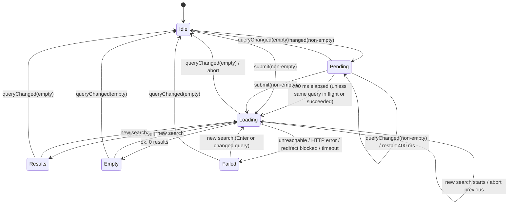

# Design Document: Search Packages

## Overview

This feature turns the existing Search_Box into a Go package search backed by pkg.go.dev. Typing (after a 400 ms pause) or pressing Enter starts a search. The extension host fetches the pkg.go.dev HTML results page, extracts the results, and sends them to the webview. The webview shows them below the Search_Box with a status line and a loading bar. Activating a result opens its pkg.go.dev page in the default browser.

The design keeps the two-layer split from the `goget-manager-extension` spec:

1. **Pure core (`src/core/`)**: no `vscode` import. New modules: the query URL builder and URL allow-list, the HTML tokenizer and results parser, search status and log messages, the webview message protocol and validator, the result view model, and the `SearchController` that owns debounce, cancellation, timeout, stale-response protection, and view state. The controller depends only on small injected interfaces, so it runs under plain Node with fake timers and a fake client.
2. **VS Code adapter layer (`src/vscode/`)**: the HTTPS transport (`node:https`), the `PkgGoDevSearchClient` redirect policy, the extended `SearchViewProvider` that relays messages, and wiring in `extension.ts` (`openExternal`, error notifications, output channel).

The webview (`src/webview/search.ts` → `media/search.js`) stays thin: it posts the raw Search_Box text and result activations to the host and renders the state it receives using DOM text APIs only.

### Key Design Decisions

| Decision | Rationale |
|---|---|
| Debounce, cancellation, timeout, and state live in the extension host (`SearchController`), not the webview | Requirement 7.5 needs searches to finish and keep their outcome while the view is hidden or re-resolved. The host outlives the webview, and the existing `KeyedDebouncer` and `TimerApi` let the logic be tested with fake timers. The webview only renders the host's state. |
| The host makes the HTTP request; the webview CSP stays `default-src 'none'` with no `connect-src` (only `img-src data:` is added for the CSS mask icons) | Assumption 6 and Requirement 8. The webview cannot reach the network at all. |
| `node:https` instead of global `fetch` | The extension targets VS Code `^1.85.0`. VS Code applies the user's `http.proxy` settings to extensions through the Node `http`/`https` modules ([Network connections in VS Code](https://code.visualstudio.com/docs/setup/network)); proxy support for `fetch` in the extension host arrived only in later releases. `https` also gives direct control over redirects (never followed automatically) and body size. |
| Redirects are followed manually, at most 5 hops, only to `https://pkg.go.dev` | Requirements 8.2 and 8.3. Every hop is checked by the same pure `isPkgGoDevHttpsUrl` predicate used for opening package pages. |
| Hand-written, linear HTML tokenizer and stack-based extractor, no dependency | The extension has no runtime dependencies, and the existing spec uses a hand-written parser for the same reasons (pure, fast, exact behavior). Only a handful of elements and attributes are needed. A single `indexOf`-driven pass handles 5 MB well within 1 s (Requirement 3.1) and never throws on malformed input (Requirement 3.8). |
| Results are located by pkg.go.dev's CSS classes and `data-test-id` attributes from `sample-pages/SearchResults.html` | `data-test-id` values (`snippet-title`, `snippet-synopsis`, `snippet-published`, `snippet-license`) exist for pkg.go.dev's own tests and are the most stable hooks on the page. All selectors live in one constant table so a markup change is a one-file fix. |
| Webview renders with `createElement` + `textContent` only, never `innerHTML` | Requirement 4.4. Values are inert text whatever they contain. The CSP (no inline script, nonce only) is a second layer. |
| Each result is a `<button>` inside a `<li>` | Buttons are in the Tab order and fire one `click` for mouse, Enter, and Space (Requirements 5.1, 5.2). Listening to `click` only guarantees exactly one open request per activation. `aria-label` is set to the package path (Requirement 5.3). |
| The webview sends an opaque `{ resultsVersion, index }` to open a result; the host looks up the path in its own state | The webview never supplies a URL or path, so a compromised or buggy webview cannot make the host open arbitrary URLs. See the note on Requirement 8.7 below. |
| Debounced (non-Enter) searches are skipped when the Search_Query equals the query of the latest started search and that search is in flight or succeeded | Typing a trailing space or retyping the same text does not refetch. Enter always starts a search (Requirement 1.1), and a failed search is retried by any change (Requirement 6.8 covers Enter). |
| Log lines quote the Search_Query and package path with `JSON.stringify` | Guarantees "exactly one line" (Requirement 6.6) even if a message from the webview contains a newline, and makes leading/trailing spaces visible. |

### Notes on the requirements

These points need a decision from you. The design follows the option shown, and I can change either the design or `requirements.md` if you prefer.

1. **Requirement 8.7 and opening a result.** 8.7 says the webview passes only the Search_Query to the host. Requirement 5 needs the webview to tell the host which result was activated. The design sends an opaque `{ resultsVersion, index }` pair (no text, no URL) plus a payload-free `ready` message. Suggested wording for 8.7: "pass only the Search_Box text, the position of an activated Result_List entry, and a ready signal".
2. **Lone surrogates in the query (Requirement 2.3).** A string with an unpaired UTF-16 surrogate has no UTF-8 encoding, so no URL encoding can round-trip it. The builder replaces each lone surrogate with U+FFFD before encoding (the same thing `TextEncoder` does), and Property 1 quantifies over well-formed strings. Users can only produce such strings by pasting broken text.
3. **Request headers (Requirement 8.1).** Each request sends three fixed headers that carry no user or workspace data: `Accept: text/html`, `Accept-Encoding: identity`, and `User-Agent: goget-manager-vscode`. No cookie jar exists in `node:https`, and no `Authorization` header is set. The VS Code proxy layer may add proxy credentials on the hop to the user's own proxy; those never reach pkg.go.dev.

## Architecture

```mermaid
flowchart TB
    subgraph Webview["Search webview (media/search.js, no network)"]
        BOX["Search_Box input"]
        LIST["Result_List / Status_Message / Loading_Indicator<br/>render via textContent"]
    end
    subgraph Host["VS Code Extension Host"]
        EXT["extension.ts"]
        subgraph Adapter["src/vscode"]
            SVP["SearchViewProvider<br/>message relay"]
            CLIENT["PkgGoDevSearchClient<br/>redirect policy, 5 MB cap"]
            TRANSPORT["nodeHttpsTransport<br/>(node:https, VS Code proxy)"]
            OUT["OutputChannel 'Goget Manager'"]
            OPEN["env.openExternal / showErrorMessage"]
        end
        subgraph Core["src/core (pure)"]
            CTRL["SearchController<br/>debounce, cancel, timeout, state"]
            URLB["searchQuery<br/>toSearchQuery, buildSearchUrl,<br/>isPkgGoDevHttpsUrl, packagePageUrl"]
            PARSER["resultsParser<br/>parseSearchResults"]
            TOK["htmlTokens<br/>tokenizer + entity decoding"]
            MSG["messages (search texts, log lines)"]
            PROTO["searchProtocol<br/>parseWebviewMessage"]
            DEB["KeyedDebouncer (existing)"]
            VM["resultView<br/>toResultEntry"]
        end
    end
    PKG[("pkg.go.dev<br/>/search?q=…&m=package")]

    BOX -->|"query / submit / open / ready"| SVP
    SVP --> PROTO
    SVP --> CTRL
    CTRL -->|state| SVP
    SVP -->|"state message"| LIST
    CTRL --> DEB
    CTRL --> URLB
    CTRL --> PARSER
    PARSER --> TOK
    CTRL --> MSG
    CTRL -->|search(url, signal)| CLIENT
    CLIENT --> URLB
    CLIENT --> TRANSPORT
    TRANSPORT -->|HTTPS GET| PKG
    CTRL --> OUT
    CTRL --> OPEN
    LIST -.-> VM
    EXT --> SVP
    EXT --> CTRL
```

The Installed_View pipeline (`GoModRepository` → `InstalledTreeProvider`) is not touched. `SearchController` has no reference to it, which is how Requirement 7.1 is met.

### Search lifecycle

```mermaid
sequenceDiagram
    participant W as Webview
    participant P as SearchViewProvider
    participant C as SearchController
    participant D as KeyedDebouncer
    participant S as PkgGoDevSearchClient
    participant X as pkg.go.dev

    W->>P: {type:"query", text}
    P->>C: queryChanged(text)
    alt Search_Query empty
        C->>D: cancel
        C->>C: abort in-flight, results=[], status="", loading=false
    else non-empty
        C->>D: schedule(400 ms)
    end
    W->>P: {type:"submit", text} (Enter)
    P->>C: submit(text)
    C->>D: cancel
    C->>C: start(query): abort previous, generation++,<br/>loading=true, status="Searching…", arm 10 s timer
    C-->>P: state
    P-->>W: {type:"state", state}
    C->>S: search(url, signal)
    S->>X: GET /search?q=…&m=package
    X-->>S: 200 HTML (or 3xx → allow-list check)
    S-->>C: {kind:"ok", html}
    C->>C: drop if generation changed;<br/>parseSearchResults(html) → results, status
    C-->>P: state
    P-->>W: {type:"state", state}
    W->>P: {type:"open", resultsVersion, index}
    P->>C: open(resultsVersion, index)
    C->>C: packagePageUrl(path) → allow-list check
    C->>C: openExternal(url) / log + showError on failure
```

### Search state machine (host)



"Pending" is not visible to the user: the previous Result_List and Status_Message stay on screen while typing (Requirement 4.6).

## Components and Interfaces

### 1. Core: `src/core/searchQuery.ts`

```ts
export const PKG_GO_DEV_HOST = 'pkg.go.dev';

/** Search_Query: Search_Box text clamped to 256 code points, then trimmed. */
export function toSearchQuery(text: string): string;

/** RFC 3986 encoding: only A-Z a-z 0-9 - . _ ~ stay literal; UTF-8 bytes as %XX (uppercase). */
export function encodeQueryComponent(value: string): string;

export type SearchUrlResult = { readonly ok: true; readonly url: string } | { readonly ok: false; readonly reason: 'empty' };

/** `https://pkg.go.dev/search?q=<encoded>&m=package`, or `{ ok: false, reason: 'empty' }`. */
export function buildSearchUrl(query: string): SearchUrlResult;

/** True iff `url` parses (WHATWG URL) with protocol `https:`, hostname `pkg.go.dev`,
 *  no explicit port other than 443, and no username or password. */
export function isPkgGoDevHttpsUrl(url: string): boolean;

export type PackageUrlResult =
  | { readonly ok: true; readonly url: string }
  | { readonly ok: false; readonly reason: 'emptyPath' | 'notPkgGoDev' };

/** `https://pkg.go.dev/<path>` checked with `isPkgGoDevHttpsUrl`. */
export function packagePageUrl(path: string): PackageUrlResult;
```

- `encodeQueryComponent` first replaces lone surrogates with U+FFFD, then encodes with `TextEncoder` and writes every byte outside the unreserved set as `%` + two uppercase hex digits. This differs from `encodeURIComponent`, which leaves `!'()*` literal and throws on lone surrogates (Requirement 2.2).
- `buildSearchUrl` builds the string directly (`'https://pkg.go.dev/search?q=' + encoded + '&m=package'`) instead of using `URLSearchParams`, because `URLSearchParams` writes spaces as `+` (Requirement 2.2).
- Trimming uses `String.prototype.trim`, which removes Unicode white space and line terminators.

### 2. Core: `src/core/htmlTokens.ts`

```ts
export type HtmlToken =
  | { readonly kind: 'start'; readonly name: string; readonly attrs: ReadonlyMap<string, string>; readonly selfClosing: boolean }
  | { readonly kind: 'end'; readonly name: string }
  | { readonly kind: 'text'; readonly text: string };   // character references already decoded

/** Lazily yields tokens. Never throws. Stops at the first unterminated tag. */
export function tokenizeHtml(html: string): Iterable<HtmlToken>;

/** Decodes `&amp; &lt; &gt; &quot; &apos; &nbsp;`, `&#NNN;` and `&#xHH;`. Unknown names stay literal. */
export function decodeCharacterReferences(text: string): string;
```

Tokenizer rules (one pass, `indexOf`-driven, no backtracking regex):

- Text runs until the next `<`. A `<` not followed by `/`, `!`, `?`, or an ASCII letter is literal text.
- `<!--` skips to `-->`. `<!…>` and `<?…>` skip to the next `>`.
- `<name …>` is a start tag. Tag and attribute names are lowercased. Attribute values may be double-quoted, single-quoted, or unquoted, and are entity-decoded. A trailing `/` before `>` sets `selfClosing`.
- `</name …>` is an end tag.
- After a `script`, `style`, `textarea`, or `title` start tag, everything up to the matching `</name` (case-insensitive) is skipped (raw text, never captured).
- **Unterminated tag**: if a tag, comment, or quoted attribute value reaches end of input before its terminator, the partial tag is dropped and tokenization ends (Requirement 3.8).
- Numeric references outside U+0001–U+10FFFF or in the surrogate range decode to U+FFFD. Go's `html/template` (which renders pkg.go.dev) emits `&#34;`, `&#39;`, `&#43;`, `&amp;`, `&lt;`, `&gt;`, which are all covered.

### 3. Core: `src/core/resultsParser.ts`

```ts
export interface PackageResult {
  readonly path: string;            // required, non-empty, no whitespace
  readonly name: string;            // required, non-empty
  readonly synopsis?: string;
  readonly version?: string;
  readonly published?: string;
  readonly importedBy?: string;     // displayed text, e.g. "1,289"
}

/** Never throws. Returns entries in page order, duplicates kept. */
export function parseSearchResults(html: string): PackageResult[];
```

Selectors, from `sample-pages/SearchResults.html`, kept in one `SELECTORS` constant:

| Field | Element in the entry |
|---|---|
| Entry | `div` whose `class` tokens include exactly `SearchSnippet` |
| Title link | first `a` with `data-test-id="snippet-title"` (fallback: first `a` inside the entry's first `h2`) |
| Package path | text of `span.SearchSnippet-header-path` inside the title link |
| Package name | text of the title link, excluding the path span |
| Synopsis | first `p.SearchSnippet-synopsis` |
| Info label | first `div.SearchSnippet-infoLabel` |
| Imported by | first `strong` inside an `a` (in the info label) whose `href` contains `tab=importedby` or whose `aria-label` is `Go to Imported By` |
| Published | text of the element with `data-test-id="snippet-published"` |
| Latest version | first `strong` in the info label that is not inside the imported-by link, the published element, or `[data-test-id="snippet-license"]` |

Sample markup for one entry, trimmed:

```html
<div class="SearchSnippet">
  <div class="SearchSnippet-headerContainer"><h2>
    <a href="https://pkg.go.dev/gopkg.in/mgo.v2" data-test-id="snippet-title">
      mgo <span class="SearchSnippet-header-path">(gopkg.in/mgo.v2)</span></a></h2></div>
  <p class="SearchSnippet-synopsis" data-test-id="snippet-synopsis">Package mgo offers a rich MongoDB driver for Go.</p>
  <div class="SearchSnippet-infoLabel">
    <a href="…?tab=importedby" aria-label="Go to Imported By"><span class="go-textSubtle">Imported by </span><strong>12,013</strong></a>
    <span class="go-textSubtle"><strong>v2.0.0-...-a6b53ec</strong> published on
      <span data-test-id="snippet-published"><strong>Aug 16, 2019</strong></span></span>
    <span data-test-id="snippet-license"><a …>BSD-2-Clause</a></span>
  </div>
  <div class="go-textSubtle">Other major versions: <a …><strong>v1</strong></a></div>
  <div class="SearchSnippet-sub go-textSubtle"><strong>Other packages in module …</strong> …</div>
</div>
```

The "Other major versions" and "Other packages in module" blocks also contain `strong` elements, so the version is scoped to the info label.

Extraction algorithm (single pass over `tokenizeHtml`):

1. Keep a stack of open elements. Void elements (`area base br col embed hr img input link meta source track wbr`) and self-closing tags are not pushed. An end tag pops up to and including the nearest open element with the same name; an end tag with no match is ignored. This tolerates misnested markup.
2. A `SearchSnippet` start tag begins a new entry. If an entry is already open, it is finalized first. An entry is finalized when its `div` is popped, when the next entry starts, or at end of input.
3. Each field is a **capture**: when its element opens, a text buffer starts; text tokens append to every active capture (the name capture is paused while inside the path span). A capture **completes** when its element is popped, explicitly or because an ancestor closed. Captures still open at end of input are discarded, so cut-off text is never reported. Only the first completed capture per field per entry is kept.
4. Normalization of each completed value: collapse `/\s+/gu` to one space, then trim. The path also has one leading `(` and one trailing `)` removed, then is trimmed again (Requirement 3.2).
5. A finalized entry is emitted only when the path is non-empty and has no `/\s/u` match, and the name is non-empty (Requirements 3.6, 3.9). Optional fields that are empty after normalization are omitted (Requirement 3.5).

Because entities are decoded in the tokenizer and tags never reach the buffers, values contain neither markup nor label text such as "Imported by" or "published on" (Requirement 3.4). Example: `Oct  6, 2026` becomes `Oct 6, 2026`.

### 4. Core: `src/core/messages.ts` (extended)

```ts
export const SEARCHING = 'Searching…';                                   // U+2026
export function resultCount(n: number): string;                          // "1 result" | "<n> results"
export function noResults(query: string): string;                        // No packages found for "<query>".
export const UNREACHABLE = 'Could not reach pkg.go.dev. Check your internet connection and try again.';
export function httpError(status: number): string;                      // pkg.go.dev returned an error (HTTP <status>). Try again later.
export const TIMED_OUT = 'The search timed out. Try again.';
export function openFailedNotification(path: string): string;           // Could not open the pkg.go.dev page for <path>.

/** Output_Channel lines. `ts` is an ISO 8601 string; query and path are JSON-quoted. */
export function searchFailureLog(ts: string, query: string, failure: SearchFailure): string;
export function openRefusedLog(ts: string, path: string, reason: 'emptyPath' | 'notPkgGoDev'): string;
export function openFailedLog(ts: string, path: string, reason: string): string;
```

Log line formats:

| Event | Line |
|---|---|
| Unreachable | `[<ts>] Search for "<query>" failed: unreachable (<error code or message>)` |
| HTTP error | `[<ts>] Search for "<query>" failed: HTTP error <status>` |
| Timeout | `[<ts>] Search for "<query>" failed: timeout after 10 s` |
| Redirect blocked | `[<ts>] Search for "<query>" failed: HTTP error <status>, redirect to host <host> blocked` |
| Open refused | `[<ts>] Did not open package page for "<path>": empty package path` / `…: not an HTTPS pkg.go.dev URL` |
| Open failed | `[<ts>] Could not open package page for "<path>": <reason>` |

The redirect line covers both Requirement 6.6 (reason identifies an HTTP error with the status code) and Requirement 8.4 (target host) in a single line.

### 5. Core: `src/core/resultView.ts`

```ts
export const MAX_SYNOPSIS = 300;

export interface ResultEntry {
  readonly path: string;
  readonly name: string;
  readonly synopsis?: string;      // truncated: first 300 code points + "…" when longer
  readonly version?: string;
  readonly published?: string;
  readonly importedBy?: string;
}

export function truncateSynopsis(text: string, max?: number): string;
export function toResultEntry(result: PackageResult): ResultEntry;
```

`truncateSynopsis` reuses `clampSearchText(text, 300)` so truncation never splits a surrogate pair. This module is bundled into the webview.

### 6. Core: `src/core/searchProtocol.ts`

```ts
export interface SearchViewModel {
  readonly results: readonly PackageResult[];
  readonly status: string;            // '' when no Status_Message
  readonly loading: boolean;
  readonly resultsVersion: number;    // increments whenever `results` is replaced
}

export type WebviewToHost =
  | { readonly type: 'ready' }
  | { readonly type: 'query'; readonly text: string }
  | { readonly type: 'submit'; readonly text: string }
  | { readonly type: 'open'; readonly resultsVersion: number; readonly index: number };

export type HostToWebview = { readonly type: 'state'; readonly state: SearchViewModel };

/** Validates an untrusted message. Never throws. Clamps `text` to 256 code points.
 *  Returns undefined for unknown types, extra-typed fields, or non-integer numbers. */
export function parseWebviewMessage(value: unknown): WebviewToHost | undefined;

export const EMPTY_VIEW_MODEL: SearchViewModel;   // { results: [], status: '', loading: false, resultsVersion: 0 }
```

### 7. Core: `src/core/searchController.ts`

```ts
export type SearchFailure =
  | { readonly kind: 'unreachable'; readonly reason: string }
  | { readonly kind: 'http'; readonly status: number }
  | { readonly kind: 'redirectBlocked'; readonly status: number; readonly targetHost: string }
  | { readonly kind: 'timeout' };

export type SearchResponse =
  | { readonly kind: 'ok'; readonly html: string }
  | { readonly kind: 'failed'; readonly failure: Exclude<SearchFailure, { kind: 'timeout' }> }
  | { readonly kind: 'aborted' };

/** Resolves (never rejects) with the outcome of one search. */
export interface SearchClient {
  search(url: string, signal: AbortSignal): Promise<SearchResponse>;
}

export interface SearchControllerDeps {
  readonly client: SearchClient;
  readonly output: OutputLike;
  readonly openExternal: (url: string) => PromiseLike<boolean>;
  readonly showError: (message: string) => void;
  readonly timers?: TimerApi;          // default: global timers
  readonly now?: () => Date;           // default: () => new Date()
  readonly debounceMs?: number;        // default 400 (Debounce_Delay)
  readonly timeoutMs?: number;         // default 10_000 (Request_Timeout)
}

export class SearchController {
  constructor(deps: SearchControllerDeps);
  get state(): SearchViewModel;
  onDidChangeState(listener: (state: SearchViewModel) => void): DisposableLike;
  queryChanged(text: string): void;   // typing
  submit(text: string): void;         // Enter
  open(resultsVersion: number, index: number): Promise<void>;
  dispose(): void;                    // aborts in-flight, cancels debounce and timer
}
```

Internal fields: `generation` (incremented per started search), `inFlight?: { generation, query, abort: AbortController, timer }`, `lastStarted?: { query, outcome: 'pending' | 'ok' | 'failed' }`, and `state`.

Behavior:

- **`queryChanged(text)`**: `q = toSearchQuery(text)`. If `q` is empty: cancel the debounce, abort `inFlight`, clear `lastStarted`, and set `{ results: [], status: '', loading: false }` (Requirement 1.2). Otherwise schedule `start(q)` after 400 ms, skipping at fire time when `lastStarted.query === q` and its outcome is `pending` or `ok`. The visible state is not changed (Requirement 4.6).
- **`submit(text)`**: cancel the debounce. If `q` is empty, do nothing (Requirement 1.6). Otherwise `start(q)` immediately, even if `q` equals the last query (Requirements 1.1, 6.8).
- **`start(q)`**:
  1. Abort and clear any `inFlight` before anything else (Requirements 1.3, 8.5).
  2. `generation++`; set `loading: true`, `status: SEARCHING`, keep `results` (Requirement 6.1); emit state synchronously.
  3. Arm a 10 s timer for this generation (Requirement 6.5, measured from search start).
  4. Call `client.search(buildSearchUrl(q).url, abort.signal)` exactly once (Requirement 1.4).
- **Settlement** (response, failure, or timeout for generation `g`): ignored unless `g === generation` and `inFlight.generation === g` (Requirements 1.3, 6.9). Otherwise clear the timer and `inFlight`, then:
  - `ok`: `results = parseSearchResults(html)`. With ≥1 result: replace results, `status = resultCount(n)`. With 0: `results = []`, `status = noResults(q)` (Requirement 6.2). `loading = false`, `resultsVersion++` (Requirements 4.1, 4.5, 4.7).
  - failure: `results = []`, `loading = false`, `resultsVersion++`, status from the failure (Requirements 6.3–6.5, 8.3); write exactly one log line (Requirements 6.6, 8.4). No notification (Requirement 6.7).
  - `aborted`: ignored (only produced for searches the controller already superseded or timed out).
- **Timeout**: the timer callback aborts the request and settles generation `g` as `{ kind: 'timeout' }`.
- **`open(version, index)`**: ignored when `version !== state.resultsVersion` or `index` is out of range. Otherwise `packagePageUrl(path)`: refused → one log line, nothing opened (Requirement 5.4). Valid → `openExternal(url)`; `false` or rejection → `showError(openFailedNotification(path))` and one log line (Requirement 5.5). The state is not modified in any case.
- Listeners are called inside `try/catch`, as in `GoModRepository`.

`SearchController` imports only from `src/core`, so it lives in the pure layer even though it orchestrates I/O through its injected interfaces.

### 8. Adapter: `src/vscode/searchClient.ts`

```ts
export interface RawHttpResponse {
  readonly status: number;
  readonly location?: string;
  readonly body: string;              // UTF-8 decoded, at most maxBodyBytes bytes
}

export interface HttpTransport {
  /** Rejects with the Node error on network failure, or an AbortError when aborted. */
  get(url: string, headers: Readonly<Record<string, string>>, signal: AbortSignal, maxBodyBytes: number): Promise<RawHttpResponse>;
}

export const REQUEST_HEADERS: Readonly<Record<string, string>>;
// { Accept: 'text/html', 'Accept-Encoding': 'identity', 'User-Agent': 'goget-manager-vscode' }

export const MAX_BODY_BYTES = 5 * 1024 * 1024;
export const MAX_REDIRECTS = 5;

export class PkgGoDevSearchClient implements SearchClient {
  constructor(transport: HttpTransport);
  search(url: string, signal: AbortSignal): Promise<SearchResponse>;
}

export const nodeHttpsTransport: HttpTransport;
```

`PkgGoDevSearchClient.search`:

1. If `isPkgGoDevHttpsUrl(url)` is false, return `failed/unreachable` without sending (defensive; the builder always produces an allowed URL).
2. `transport.get(url, REQUEST_HEADERS, signal, MAX_BODY_BYTES)`.
3. Status 200–299 → `ok` with the body.
4. Status 301, 302, 303, 307, 308 with a `Location`: resolve against the current URL with `new URL(location, current)`. If the result passes `isPkgGoDevHttpsUrl` and fewer than 5 redirects were followed, repeat from step 2 with that URL. Otherwise return `redirectBlocked` with the redirect's status and the target's host (or `(invalid URL)` when it does not parse), without sending anything to the target (Requirement 8.3). Exceeding 5 hops returns `http` with the last status.
5. Any other status → `http` with that status (Requirement 6.4).
6. Transport rejection: `aborted` when `signal.aborted`, otherwise `unreachable` with the error's `code` (e.g. `ENOTFOUND`, `ECONNREFUSED`, `ECONNRESET`) or message (Requirement 6.3).

`nodeHttpsTransport.get` uses `https.request(url, { method: 'GET', headers, signal })` with no agent override, so VS Code's proxy integration applies. It never follows redirects itself. It collects body chunks until `maxBodyBytes`, then destroys the request and resolves with the truncated body, which the parser tolerates. An `error` event or `aborted`/premature `close` before `end` rejects (connection lost before a complete response).

### 9. Adapter: `src/vscode/searchViewProvider.ts` (extended)

```ts
export class SearchViewProvider implements vscode.WebviewViewProvider {
  static readonly viewId = 'gogetManager.search';
  constructor(extensionUri: vscode.Uri, controller: SearchController);
  get isResolved(): boolean;
  resolveWebviewView(view: vscode.WebviewView): void;
  dispose(): void;
}
```

- `buildSearchHtml` adds three elements after the input. The CSP is unchanged.

  ```html
  <input id="search" …existing attributes…>
  <div id="loading" class="loading" hidden aria-hidden="true"><div class="loading-bar"></div></div>
  <div id="status" class="status" role="status" aria-live="polite"></div>
  <ul id="results" class="results" aria-label="Search results"></ul>
  ```

- `webview.onDidReceiveMessage` → `parseWebviewMessage`; invalid messages are dropped. `ready` → post the current state. `query` → `controller.queryChanged`. `submit` → `controller.submit`. `open` → `controller.open`.
- `controller.onDidChangeState` → `webview.postMessage({ type: 'state', state })` for the currently resolved view. With `retainContextWhenHidden: true`, a hidden webview still receives messages. A re-resolved webview (new instance) sends `ready` and receives the latest state (Requirement 7.2).
- Subscriptions are disposed when the view is disposed or re-resolved.

### 10. Webview: `src/webview/search.ts` and `src/webview/render.ts`

`search.ts` (entry, bundled to `media/search.js`):

- On load: restore text from `getState()` (unchanged), then post `{ type: 'ready' }`. A restored non-empty text does not start a search by itself; the user presses Enter or edits the text. With empty text this yields the empty initial state (Requirement 7.6).
- `input`: `setState({ text: clampSearchText(value) })`, then post `{ type: 'query', text }`.
- `keydown` Enter (and not `isComposing`): `preventDefault()`, post `{ type: 'submit', text }`.
- `message` `{ type: 'state' }`: `renderState(state)`.
- Result `click` (fired by mouse, Enter, and Space on a button): post `{ type: 'open', resultsVersion, index }` read from `data-` attributes.

`render.ts` holds the DOM logic behind a small `DomLike` interface (`createElement`, `createTextNode`, `replaceChildren`, `setAttribute`, `textContent`, `hidden`) so unit tests can use a fake DOM, as `searchView.test.ts` already does.

- **Result_List**: rebuilt only when `resultsVersion` changes, so typing and status changes do not move focus. Each entry:

  ```html
  <li class="result">
    <button type="button" class="result-button" aria-label="<path>" aria-describedby="r<ver>-<i>-desc"
            data-version="<ver>" data-index="<i>">
      <span class="result-path"><path></span>
      <span class="result-name"><name></span>
      <span id="r<ver>-<i>-desc" class="result-desc">
        <span class="result-synopsis"><synopsis></span>
        <span class="result-meta">
          <span class="result-version"><version></span>
          <span class="result-published"><span class="result-icon icon-calendar" title="Publish date" role="img" aria-label="Publish date"></span><published></span>
          <span class="result-imported"><span class="result-icon icon-download" title="Number of import" role="img" aria-label="Number of import"></span><importedBy></span>
        </span>
      </span>
    </button>
  </li>
  ```

  Each `<…>` value is a separate text node created with `createTextNode` (Requirement 4.4). Spans for absent fields are not created (Requirement 4.8). The path comes first and uses the larger, bold style (Requirement 4.2). The icons are empty spans drawn with CSS `mask-image` and `currentColor`; the tooltip is the `title`, and `role="img"` + `aria-label` keep the meaning for screen readers.
- **Status_Message**: `textContent` is assigned only when the text differs from the current text, so the polite live region announces each change once (Requirement 7.4).
- **Loading_Indicator**: `hidden = !state.loading`. It is an indeterminate bar animated with CSS and `aria-hidden`, since the live region already announces "Searching…".

### 11. `media/search.css` (extended)

New rules use only theme variables, so a theme switch restyles without reload (Requirement 7.3):

- Results: `--vscode-foreground`, `--vscode-descriptionForeground`, `--vscode-list-hoverBackground`, `--vscode-list-activeSelectionBackground`.
- Focus: `.result-button:focus-visible { outline: 1px solid var(--vscode-focusBorder); outline-offset: -1px; }` (Requirement 5.2).
- Status: `--vscode-descriptionForeground`.
- Meta icons: `.result-icon` with `.icon-calendar` / `.icon-download` use `mask-image` data URIs on `currentColor`; the CSP therefore adds `img-src data:`.
- Loading bar: `--vscode-progressBar-background`, with `@media (prefers-reduced-motion: reduce)` replacing the animation by a static bar.

### 12. `src/extension.ts` and `src/vscode/testApi.ts`

`activate` creates `PkgGoDevSearchClient(nodeHttpsTransport)` and a `SearchController` with:

- `output` = the existing "Goget Manager" channel,
- `openExternal: (url) => vscode.env.openExternal(vscode.Uri.parse(url, true))`,
- `showError: (m) => void vscode.window.showErrorMessage(m)`,

then passes the controller to `SearchViewProvider` and pushes both into `context.subscriptions`.

`GogetManagerApi` gains a read-only `getSearchState(): SearchViewModel`. When `context.extensionMode === vscode.ExtensionMode.Test`, it also exposes `submitSearchForTest(text: string): void` so the opt-in live integration test can start a search without driving the webview DOM. Neither member exists in normal use.

No `package.json` contribution changes are needed. No other module performs network requests (Requirement 8.6).

## Data Models

```ts
// Parser output (Component 3)
interface PackageResult {
  path: string;          // e.g. "go.mongodb.org/mongo-driver/v2/mongo"
  name: string;          // e.g. "mongo"
  synopsis?: string;     // e.g. "Package mongo provides a MongoDB Driver API for Go."
  version?: string;      // e.g. "v2.9.2", "v0.0.0-...-566b635"
  published?: string;    // e.g. "Oct 6, 2026", "today"
  importedBy?: string;   // e.g. "1,289"
}

// Host → webview view state (Component 6)
interface SearchViewModel {
  results: readonly PackageResult[];
  status: string;
  loading: boolean;
  resultsVersion: number;
}

// Webview → host messages (Component 6)
type WebviewToHost =
  | { type: 'ready' }
  | { type: 'query'; text: string }           // ≤ 256 code points
  | { type: 'submit'; text: string }          // ≤ 256 code points
  | { type: 'open'; resultsVersion: number; index: number };

// Search outcome (Component 7)
type SearchFailure =
  | { kind: 'unreachable'; reason: string }
  | { kind: 'http'; status: number }
  | { kind: 'redirectBlocked'; status: number; targetHost: string }
  | { kind: 'timeout' };

// Webview persisted state (unchanged from the existing spec)
interface SearchViewState { text: string; }
```

Status_Message texts:

| State | Text |
|---|---|
| Idle (empty query) | empty |
| Loading | `Searching…` |
| N ≥ 2 results | `<N> results` |
| 1 result | `1 result` |
| 0 results | `No packages found for "<Search_Query>".` |
| Unreachable | `Could not reach pkg.go.dev. Check your internet connection and try again.` |
| HTTP error or blocked redirect | `pkg.go.dev returned an error (HTTP <status code>). Try again later.` |
| Timeout | `The search timed out. Try again.` |

Constants: `DEBOUNCE_MS = 400`, `REQUEST_TIMEOUT_MS = 10_000`, `MAX_BODY_BYTES = 5 MiB`, `MAX_REDIRECTS = 5`, `MAX_SYNOPSIS = 300`, `MAX_SEARCH_TEXT = 256` (existing).

New and changed files:

```
src/core/      searchQuery.ts, htmlTokens.ts, resultsParser.ts, resultView.ts,
               searchProtocol.ts, searchController.ts, messages.ts (extended)
src/vscode/    searchClient.ts (new), searchViewProvider.ts, testApi.ts (extended)
src/webview/   search.ts (extended), render.ts (new)
src/extension.ts (wiring)
media/search.css (extended)
test/unit/     search*.test.ts, properties/sp01-…sp12-*.test.ts, searchArbitraries.ts
test/fixtures/ search-results/*.html (sample page copy and hand-made edge pages)
test/integration/ search.test.ts (+ .vscode-test.mjs entry)
```

## Correctness Properties

*A property is a characteristic or behavior that should hold true across all valid executions of a system-essentially, a formal statement about what the system should do. Properties serve as the bridge between human-readable specifications and machine-verifiable correctness guarantees.*

The properties target the pure core (`src/core/`), the webview renderer (`src/webview/render.ts`) with a fake DOM, and `PkgGoDevSearchClient` with a fake transport. VS Code view lifecycle, theme switching, focus visuals, and the network itself are covered by example, smoke, and integration tests in the Testing Strategy.

During property reflection, overlapping criteria were merged: URL shape, parameter isolation, and round trip form one property (1); the parser's field rules (3.1–3.5) form one model-based property (3); 3.8 and 3.9 form one totality property (5); all rendering criteria form one property (6); status texts are asserted inside the controller outcome property (9) against literal templates rather than as a separate formatting property.

Shared generators (`test/unit/searchArbitraries.ts`):

- **Query**: well-formed strings of 1–256 code points with no leading/trailing white space, biased toward `& = # + % ? / space`, `!'()*`, non-ASCII, and astral characters.
- **Box text**: any string up to 300 code points, including empty and whitespace-only strings.
- **Entry spec**: `{ path, name, synopsis?, version?, published?, importedBy? }`, where each optional field is absent, empty, whitespace-only, or a value. Values include `<`, `>`, `&`, quotes, `Imported by`, `published on`, and runs of white space. Paths are non-empty with no white space; names are non-empty after normalization.
- **Page renderer** (test-only): renders entry specs in the markup shape of `sample-pages/SearchResults.html`, with noise: random indentation and newlines, extra attributes and classes, random character references (`&amp;`, `&#34;`, `&#43;`, `&#x27;`), inline wrapper tags inside values, "Other major versions" and "Other packages in module" blocks with their own `strong` elements, comments, and `script`/`style` blocks containing fake `SearchSnippet` markup.
- **Event script** (controller): a list of `query(text)`, `submit(text)`, `advance(ms)`, `settle(searchIndex, outcome)` steps, where outcomes are `ok(html)`, each failure kind, or `aborted`, and settlements may target any earlier search in any order.

### Property 1: Search URL structure and query round trip

*For any* well-formed query of 1 to 256 code points, `buildSearchUrl(query)` SHALL return a URL that parses with protocol `https:`, host `pkg.go.dev`, path `/search`, and exactly two query parameters, `q` and `m`, in that order, with `m` equal to `package`; and percent-decoding the raw `q` value (as UTF-8) SHALL yield `query` exactly.

**Validates: Requirements 2.1, 2.3, 2.4**

### Property 2: Query encoding uses only unreserved characters and uppercase UTF-8 escapes

*For any* well-formed string `s`, `encodeQueryComponent(s)` SHALL match `^([A-Za-z0-9\-._~]|%[0-9A-F]{2})*$`, SHALL keep each unreserved character of `s` literal, and SHALL write every other character as the `%XX` sequence of its UTF-8 bytes, so that a space becomes `%20` and `+` becomes `%2B`.

**Validates: Requirements 2.2**

### Property 3: Parsing a rendered results page returns its entries

*For any* list of valid entry specs (including duplicate paths) rendered by the page renderer with any noise, `parseSearchResults` SHALL return one `PackageResult` per entry in the same order, where `path` is the spec path, `name` is the spec name, and each optional field equals the spec value after entity decoding, white-space collapsing, and trimming, or is absent when the spec field is absent or normalizes to empty.

**Validates: Requirements 3.1, 3.2, 3.3, 3.4, 3.5**

### Property 4: Invalid entries are dropped without disturbing the rest

*For any* page rendered from a mix of valid entry specs and invalid ones (missing path span, empty or whitespace-only path, path containing white space, or missing or empty name) in any order, `parseSearchResults` SHALL return exactly the results for the valid entries, in their original relative order.

**Validates: Requirements 3.6**

### Property 5: The parser is total and its output is well formed on any input

*For any* string, including arbitrary text, generated pages, and generated pages cut at any offset, `parseSearchResults` SHALL return without throwing, every returned `path` SHALL be non-empty with no white space and every `name` non-empty, and for a page cut at any offset the sequence of returned paths SHALL be a prefix of the sequence of paths returned for the uncut page.

**Validates: Requirements 3.7, 3.8, 3.9**

### Property 6: Results render as complete, ordered, plain-text entries

*For any* list of `PackageResult` values whose fields may contain markup characters, rendering a state with those results into the fake DOM SHALL produce exactly one button entry per result in the same order, each with `aria-label` equal to the path, the path as the first text node, the name in a separate element, each present optional field as a text node equal to its value (the synopsis equal to `truncateSynopsis(synopsis)`, which is the first 300 code points plus `…` when longer and the unchanged synopsis otherwise), no element for absent fields, only elements from the renderer's fixed tag set, and no write to `innerHTML`.

**Validates: Requirements 4.1, 4.2, 4.3, 4.4, 4.8, 5.3**

### Property 7: Searches start only as typing, Enter, and clearing dictate

*For any* event script of box-text changes, Enter presses, and time advances on fake timers, the searches started by `SearchController` SHALL equal those of a reference model in which: each Enter with a non-empty Search_Query starts exactly one search at that instant and cancels the pending debounce; a non-empty text change starts a search 400 ms later unless another text change, Enter, or clearing happens first, or the Search_Query equals that of the latest started search while it is in flight or succeeded; an empty Search_Query cancels the pending debounce. Additionally, no search SHALL ever be started with an empty Search_Query, each started search SHALL make exactly one `client.search` call with `buildSearchUrl(query).url`, and text changes and empty Enter presses SHALL leave the visible state unchanged except that an empty Search_Query clears it to empty results, empty status, and no loading.

**Validates: Requirements 1.1, 1.2, 1.4, 1.5, 1.6, 4.6**

### Property 8: The latest search wins and at most one request is in flight

*For any* event script with settlements and timeouts delivered in any order, including for superseded searches: immediately after each search starts, the state SHALL show `loading: true`, status `Searching…`, and the previous results; at every `client.search` call, every earlier request's signal SHALL be aborted or that request SHALL be settled; outcomes for any search other than the latest started and not-cleared one SHALL leave the state unchanged; and once the latest search settles or times out, the state SHALL equal that search's outcome with `loading: false`.

**Validates: Requirements 1.3, 4.7, 6.1, 6.5, 6.9, 8.5**

### Property 9: Search outcomes map to the exact view state and one log line

*For any* query (including ones containing quotes and newlines) and *for any* outcome of the latest search, the resulting state and side effects SHALL be:
- `ok` with N ≥ 1 parsed results: those results, status `1 result` when N = 1 and `<N> results` otherwise;
- `ok` with 0 results: no results, status `No packages found for "<query>".`;
- `unreachable`: no results, status `Could not reach pkg.go.dev. Check your internet connection and try again.`;
- `http` with any status outside 200–299, or `redirectBlocked` with any 3xx status: no results, status `pkg.go.dev returned an error (HTTP <status>). Try again later.`;
- `timeout`: no results, status `The search timed out. Try again.`;

with `loading: false` in every case. For every failure, exactly one Output_Channel line SHALL be written, containing no line break, the ISO 8601 timestamp from the injected clock, the JSON-quoted query, and the failure reason (`unreachable`, `HTTP error <status>`, or `timeout`), plus the target host for `redirectBlocked`; and `showError` SHALL never be called.

**Validates: Requirements 4.5, 6.2, 6.3, 6.4, 6.6, 6.7, 8.3, 8.4**

### Property 10: The search client contacts only HTTPS pkg.go.dev with fixed headers

*For any* query and *for any* chain of transport responses (2xx bodies, non-2xx statuses, and redirects whose `Location` is relative, absolute, another host, `http:`, a non-default port, with credentials, a lookalike such as `pkg.go.dev.evil.com`, or malformed), every URL passed to `transport.get` SHALL satisfy `isPkgGoDevHttpsUrl`, every request's headers SHALL equal `REQUEST_HEADERS`, the first URL SHALL be `buildSearchUrl(query).url`, and the first redirect to a disallowed target SHALL end the search with `redirectBlocked` carrying that response's status and the target host, with no request sent to the target.

**Validates: Requirements 8.1, 8.2, 8.3**

### Property 11: Package pages open only as HTTPS pkg.go.dev URLs built from the displayed path

*For any* path string, `packagePageUrl(path)` SHALL return `emptyPath` for the empty string, and otherwise either `ok` with `url === 'https://pkg.go.dev/' + path` and `isPkgGoDevHttpsUrl(url)` true, or `notPkgGoDev`; *for any* path made of Go import path characters it SHALL return `ok`. *For any* displayed results and index, `SearchController.open` SHALL call `openExternal` exactly once with that URL when it is `ok`, or write exactly one log line containing the JSON-quoted path and the refusal reason and not call `openExternal` otherwise, and SHALL leave the state unchanged in both cases.

**Validates: Requirements 5.1, 5.4**

### Property 12: Messages across the webview boundary carry only allowed data

*For any* JSON-compatible value, `parseWebviewMessage` SHALL return without throwing, and SHALL return either `undefined` or one of `{type:'ready'}`, `{type:'query'|'submit', text}` with `text` of at most 256 code points, or `{type:'open', resultsVersion, index}` with non-negative integers, with no other properties. *For any* controller state, the message the provider posts SHALL have exactly the keys `type` and `state`, and `state` exactly the keys `results`, `status`, `loading`, and `resultsVersion`, with each result having only `PackageResult` keys.

**Validates: Requirements 8.7**

## Error Handling

| Condition | Detection | User-visible result | Logging |
|---|---|---|---|
| DNS failure, connection refused or reset, TLS error, connection lost mid-body | Transport rejects (not aborted) | Results cleared, "Could not reach pkg.go.dev. Check your internet connection and try again." | `… failed: unreachable (<code or message>)` |
| Non-2xx status (including 3xx without `Location`, more than 5 redirects) | `status` outside 200–299 | Results cleared, "pkg.go.dev returned an error (HTTP <status>). Try again later." | `… failed: HTTP error <status>` |
| Redirect to another host, `http:`, a non-default port, credentials, or an unparsable `Location` | `isPkgGoDevHttpsUrl` false on the resolved target | Same HTTP error text with the redirect status | `… failed: HTTP error <status>, redirect to host <host> blocked` |
| No complete response 10 s after the search started | Controller timer | Request aborted, results cleared, "The search timed out. Try again." | `… failed: timeout after 10 s` |
| Response body over 5 MB | Byte counter in the transport | Body truncated at 5 MB and parsed; results from complete entries are shown | None |
| pkg.go.dev markup changed so no entries are found | Parser returns `[]` | `No packages found for "<query>".` | None. This is indistinguishable from a real empty result; the selector table is the single place to update. |
| Malformed or truncated HTML | Tokenizer stops at an unterminated tag; captures still open are discarded | Results from fully read entries | None |
| Response, error, or timeout for a superseded or cleared search | Generation mismatch | Ignored | None |
| Search_Query becomes empty during a search | `queryChanged` | Request aborted, list and status cleared | None |
| Invalid message from the webview | `parseWebviewMessage` returns `undefined` | Ignored | None |
| `open` for a stale `resultsVersion` or out-of-range index | Controller check | Ignored | None |
| Empty package path or URL that is not HTTPS pkg.go.dev | `packagePageUrl` refuses | Nothing opened, list unchanged | `Did not open package page for "<path>": <reason>` |
| `openExternal` returns `false` or rejects | Controller | Error notification "Could not open the pkg.go.dev page for <path>.", list unchanged | `Could not open package page for "<path>": <reason>` |
| A state listener throws | `try/catch` in the controller | Other listeners still run | Logged with stack |
| Extension deactivates mid-search | `SearchController.dispose` | Request aborted, timers cleared | None |

Search failures never show a notification or modal (Requirement 6.7). The only notification in this feature is the open-failure one required by Requirement 5.5. The client and controller never reject or throw into VS Code; every async path ends in a state update or is ignored.

## Testing Strategy

### Tools

The existing setup is reused unchanged:

- **Unit and property tests**: Vitest (`npm test`, which runs `vitest --run`) in Node, with fast-check `4.10.2` for property-based tests. The `vscode` module is aliased to `test/unit/vscodeStub.ts`; the new core modules do not import it.
- **Fakes**: the `FakeTimers` pattern from `p13-debouncer.test.ts` (moved to a shared helper), a deferred-based fake `SearchClient`, a recording fake `HttpTransport`, a recording `OutputLike`, and a fake DOM for the renderer, following the fake `document` approach of `searchView.test.ts`.
- **Integration tests**: `@vscode/test-cli` + Mocha in a real VS Code, built by `esbuild.integration.mjs`.

No new dependencies are needed.

### Property-Based Tests

- Each of Properties 1–12 is implemented by exactly one fast-check property test in `test/unit/properties/sp<NN>-<slug>.test.ts`.
- Each runs at least 100 iterations (`fc.assert(prop, { numRuns: 100 })` or more; the parser properties use 200).
- Each carries a tag comment in this format:
  `// Feature: search-packages, Property 1: Search URL structure and query round trip`
- Properties 7 and 8 drive `SearchController` with `FakeTimers`, the fake client, and a fixed clock, so they run in milliseconds.
- Property 5 uses `fc.string({ unit: 'binary' })` for arbitrary text and `fc.nat` cut offsets over pages from the renderer.
- Property 10 runs `PkgGoDevSearchClient` against the recording transport only; no sockets are opened.

### Unit Tests (example-based)

- **URL builder**: `buildSearchUrl('')` returns `{ ok: false, reason: 'empty' }` (Requirement 2.5); `mongodb` → `https://pkg.go.dev/search?q=mongodb&m=package`; `a b+c&d=e#f` → `q=a%20b%2Bc%26d%3De%23f`; a lone surrogate encodes as `%EF%BF%BD`.
- **Parser**:
  - a copy of `sample-pages/SearchResults.html` in `test/fixtures/search-results/` yields 25 results whose first entry is `{ path: 'go.mongodb.org/mongo-driver/v2/mongo', name: 'mongo', synopsis: 'Package mongo provides a MongoDB Driver API for Go.', version: 'v2.9.2', published: 'Oct 6, 2026', importedBy: '1,289' }`, and whose `github.com/kamva/mgm/v3` entry has no synopsis;
  - empty string and a no-results page return `[]` (Requirement 3.7);
  - unterminated tag inside the third entry keeps the first two (Requirement 3.8);
  - a synthetic 5 MB page parses in under 1 s (Requirement 3.1).
- **Controller**:
  - a new controller has `EMPTY_VIEW_MODEL` and makes no client call (Requirements 1.5, 7.6);
  - Enter after a failure re-searches the same query (Requirement 6.8);
  - the timeout counts from search start, across a slow redirect chain (Requirement 6.5);
  - `openExternal` returning `false` and rejecting each produce one notification and one log line with the list unchanged (Requirement 5.5).
- **Search client**: a 3xx with no `Location` maps to `http`; six same-host redirects map to `http` with the last status; an aborted signal maps to `aborted`.
- **Transport** (with `https.request` stubbed by `vi.spyOn`, so no sockets or certificates are needed): body capped at `MAX_BODY_BYTES`; `close` before `end` rejects; no `redirect`-following option is set.
- **Provider** (fake webview): `ready` posts the current state; invalid messages are ignored; a state change while the view is hidden is delivered; a re-resolved view that sends `ready` gets the latest state, including the outcome of a search that finished meanwhile (Requirements 7.2, 7.5).
- **Webview script** (fake `acquireVsCodeApi` and DOM, updating the existing `searchView.test.ts`): `input` posts `query` and saves state; Enter posts `submit` and calls `preventDefault`, but not while `isComposing`; a result `click` posts one `open` (Requirement 5.1); the same status rendered twice assigns `textContent` once, and the status element has `role="status"` and `aria-live="polite"` (Requirement 7.4). The existing test "never calls postMessage" is replaced, since this feature supersedes Requirement 3.5 of the earlier spec.
- **HTML builder**: `buildSearchHtml` contains `#loading` (hidden), `#status` (`role="status"`, `aria-live="polite"`), and `#results`, keeps the CSP with no `connect-src`, and still has exactly one input.

### Smoke Tests

- `media/search.css` references `--vscode-focusBorder` in a `.result-button:focus-visible` rule, `--vscode-progressBar-background`, `--vscode-descriptionForeground`, and `--vscode-list-hoverBackground`, and contains no hard-coded color values in the new rules (Requirements 5.2, 7.3).
- A source scan asserts that only `src/vscode/searchClient.ts` imports `node:https`, `https`, `http`, `net`, or `tls`, and that no file under `src/` calls `fetch(`, `XMLHttpRequest`, `WebSocket`, or `navigator.sendBeacon` (Requirement 8.6).

### Integration Tests (VS Code host)

Added as `test/integration/search.test.ts` with a `search` entry in `.vscode-test.mjs` that opens the `single-folder` fixture:

- after activation, the Search view resolves and `getSearchState()` equals the empty model with no loading (Requirement 7.6);
- **opt-in live test**, run only when `GOGET_LIVE_SEARCH=1`: `submitSearchForTest('mongodb')` yields at least one result within 15 s, `go.mongodb.org/mongo-driver/v2/mongo` or another `mongo` package is among them, and `getInstalledTree()` is identical before and after (Requirement 7.1). It is opt-in so CI does not depend on pkg.go.dev availability.

### Manual Verification Checklist

- Tab order and focus outline on results; Enter and Space open the page in the browser (Requirements 5.1, 5.2).
- Screen reader reads the path as each result's name and announces status changes once (Requirements 5.3, 7.4). Full accessibility validation also needs testing with assistive technologies.
- Theme switch while results are shown, in light, dark, and high-contrast themes (Requirement 7.3).
- Collapse the Search section and hide the container during a search, then reopen (Requirements 7.2, 7.5).
- Behavior behind an HTTP proxy configured through `http.proxy`.
